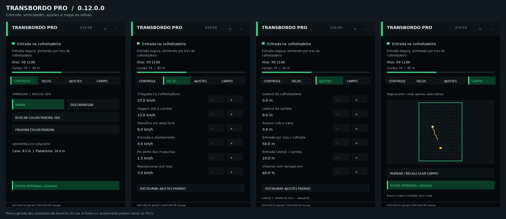

# Mods para Farming Simulator 25

## Transbordo Inteligente PRO — versão de teste 0.12.0.0

[Baixar FS25_TransbordoInteligente.zip](FS25_TransbordoInteligente.zip) · [Instruções](transbordo-inteligente/LEIA-ME.md) · [Código Lua](transbordo-inteligente/TransbordoInteligente.lua)

Atende colheitadeiras com pelo menos 60% de grãos, com jogador ou funcionário nativo. Identifica a bazuca acoplada e usa a posição real do cano aberto e do receptor para alinhar o conjunto. Ao encher, procura a carreta ou caminhão com caçamba compatível mais próximo da borda do talhão, descarrega quando a engine confirmar o receptor e reinicia o ciclo.

**A versão 0.12 substitui os textos do centro da tela por um HUD lateral interativo.** O painel pode ser recolhido e arrastado pelo botão `::`. As configurações são independentes por trator e ficam salvas na partida; o automático permanece desligado ao carregar o jogo.



Prévia gerada pelos comandos de desenho do Lua; não é uma captura dentro do FS25.

| Aba | Controles |
| --- | --- |
| Controle | Iniciar/parar, descarregar, buscar colheitadeiras em 360°, trocar de alvo e consultar geometria |
| Velocidades | Chegada à colheitadeira, viagem à carreta, manobra, entrada, ré e reposicionamento |
| Ajustes | Deslocamentos laterais separados, avanço sob o cano, recuos de entrada e percentual de chamada |
| Campo | Mapear/recalcular o talhão, visualizar trator/alvo/rota e ativar rotas internas opcionais |

**Ctrl+Alt+H** recolhe/abre o painel. **Ctrl+Alt+M** libera/recolhe o mouse; ao recolher, sair do veículo ou abrir o menu, restaura a câmera. Os atalhos **Ctrl+Alt+T** e **Ctrl+Alt+D** continuam funcionando. O botão de busca 360° pode selecionar uma colheitadeira com grãos antes do percentual automático, inclusive atrás do trator, conservando fazenda, grão compatível, reserva e talhão.

As rotas internas vêm desligadas. Na aba Campo, mapeie e ative a opção para calcular passagens dentro do contorno, incluindo recortes do campo. O mapa considera a folga do conjunto e os veículos selecionados; a proteção articulada continua autorizando cada movimento. Não lê ruas, árvores ou postes. Sem corredor interno reconhecido, aguarda; é possível desligar Rotas e continuar pela direção direta com o bloqueio do campo mantido.

O cálculo do receptor da bazuca usa o conjunto alinhado e o engate medido, evitando que a articulação altere o ponto final de chegada. Quando a entrada fica bloqueada perto de uma colheitadeira parada, tenta alinhar por trás antes de avançar sob o cano. Junto da carreta, mantém as tentativas progressivas de frente e ré dentro do mesmo campo.

O mapeamento mede a largura e o comprimento da carreta, a largura da bazuca, o alcance lateral real do cano, o engate e a cabine do caminhão. Compara posições de descarga nos dois sentidos e descarta as que sobrepõem carrocerias ou ultrapassam o talhão. O HUD mostra as medidas, as posições livres e a folga lateral mapeada. Usa a faixa útil da caçamba informada pelo modelo; sem essa faixa, usa somente o ponto de enchimento conhecido. A largura externa não cria uma abertura de carga fictícia. A engine continua precisando confirmar exatamente a carreta e o compartimento corretos.

As tentativas são limitadas em área, percurso, processamento e trocas de marcha. A maior pode precisar de mais espaço interno; se nenhuma tentativa encontrar passagem, permanece freado e ligado. Não sai do campo para completar uma manobra nem amplia artificialmente o cano.

**O limite do talhão continua ativo.** Ative com trator e bazuca dentro do campo: o contorno fica fixo até desligar. A previsão verifica o conjunto inteiro, inclusive a traseira da bazuca em ré, antecipa giros para dentro e solicita frenagem antes da borda. Sem um contorno válido, aguarda parado. Se detectar o conjunto já fora, interrompe a condução e informa para reposicioná-lo dentro; não muda de campo nem tenta voltar pela rodovia.

A captura percorre veículos e implementos sem duplicá-los, ignora leituras inválidas e procura outro receptor de enchimento quando a mira está ausente ou removida. Com o cano aberto, prioriza colheitadeiras com posição de atendimento e entrada traseira utilizáveis, mantendo a preferência pela mais cheia entre candidatas equivalentes. Uma falha breve de leitura da colheitadeira preserva a reserva por até 2 s.

Durante uma curva da colheitadeira, aguarda a direção estabilizar em vez de perseguir o cano em movimento. Chegar ao ponto traseiro atravessado não conclui mais a entrada: alinha a direção antes de avançar. O cálculo usa deslocamentos horizontais medidos do cano e da caçamba, com direção normalizada, e o painel identifica **o veículo selecionado e o campo fixado**.

**Ctrl+Alt+D solicita levar a carga atual para a carreta**, mesmo parcialmente cheia. A busca se repete a cada 250 ms e só aceita receptores no campo ou na borda alcançável pelo cano, com espaço para manter trator e bazuca dentro. Continua exigindo mesma fazenda, grão aceito, capacidade livre, caminhão parado e confirmação exata do receptor pelo jogo. A descarga local só é liberada com o cano próximo da faixa útil de recebimento.

O acompanhamento da colheitadeira mantém tolerâncias de **10 cm longitudinal e 15 cm lateral**, aplicadas à posição corrigida pelo usuário. Nos padrões, a chegada permite até **25 km/h** em trecho distante e alinhado; a viagem à carreta usa até **15 km/h**. A aproximação, a entrada, a ré e as curvas reduzem a velocidade. Os valores do painel são limites pedidos; as proteções podem reduzir mais. Os deslocamentos laterais positivos apontam para a direita da máquina atendida. Alterá-los não estende o cano nem força a transferência de grãos.

Se a colheitadeira esvaziar antes da bazuca, aguarda a próxima carga ou atende outra máquina elegível do mesmo campo. Depois de descarregar no caminhão, libera a lateral e reinicia o ciclo. A recuperação considera falta de progresso. A entrada sob o cano continua sendo por trás e para frente; quando já chega paralelo ao lado da máquina, pode recuar em linha reta a até 3 km/h para se posicionar atrás, respeitando a borda. Não exige reativar entre ciclos.

A proteção mede separadamente o corpo da colheitadeira e a plataforma engatada. Na centralização final e no reposicionamento reto em baixa velocidade relativa, pode reduzir a folga entre máquinas de 0,75 m para 0,20 m. A folga do limite do campo permanece em 0,35 m. Contato previsto com a plataforma ou com o caminhão continua bloqueando o avanço. Reservar o caminhão não remove a proteção da colheitadeira durante a saída.

As rotas opcionais são restritas ao talhão; não há navegação em ruas nem leitura de cultura. O limite usa o contorno original do campo informado pelo mapa, sem acompanhar automaticamente alterações por arado ou edição de terreno. A proteção não é um detector geral de postes e árvores dentro do talhão. Se não houver espaço para manobrar, receber ou descarregar dentro do campo, aguarda reposicionamento.

Para atravessar cultura sem dano de rodas, o módulo usa o bloqueio nativo `getBlockFoliageDestruction` no trator e nos implementos acoplados enquanto estiver ativo. Não ativa nem altera a opção global de destruição de cultura da partida. Ao desligar ou desacoplar, restaura o comportamento anterior. Trabalho de ferramentas, como arar ou colher, é independente desse bloqueio de rodas.

Feche o jogo, substitua o ZIP pelo arquivo **0.12.0.0** e remova cópias antigas deste mod. Posicione o conjunto inteiro dentro do talhão e deixe o caminhão em uma borda alcançável por dentro. As quatro ações aparecem em **Opções > Controles** e na ajuda **F1**. Confira **TRANSBORDO PRO** e **0.12.0.0** no painel. Desligue e reative ao trocar de campo.

**Versão experimental, single-player.** Os 209 testes simulados incluem botões e abas do HUD, mouse/câmera, atalhos, salvamento de ajustes, busca de veículos atrás do trator, rota acompanhada em campo côncavo, permanência do conjunto no campo e recuperação da entrada junto da plataforma. Mantêm os testes anteriores de alinhamento, carreta, captura, carga, ciclos e dano por rodas. A física, a renderização nativa e os modelos escolhidos ainda precisam de confirmação no FS25.

### Desenvolvimento

As fontes, manifesto, registro, testes e empacotador estão em [`transbordo-inteligente/`](transbordo-inteligente/). `TIHUD.lua` desenha o painel e trata o mouse; `TIConfiguracao.lua` valida e salva os ajustes; `TIRotasCampo.lua` calcula o mapa e as rotas internas opcionais. `TIManobraCarreta.lua` acompanha ajustes e entradas locais; `TIProtecao.lua` e `TITalhao.lua` conferem as carrocerias e o limite. O antigo `TINavegacao.lua` continua removido; use o ZIP completo atualizado.

Com Python 3 e `lupa==2.6`:

```bash
cd transbordo-inteligente
python -m unittest discover -s tests -v
python package.py
cp FS25_TransbordoInteligente.zip ../FS25_TransbordoInteligente.zip
```

## TG GPS PRO — versão de teste 0.9.0.0

[Baixar FS25_TG_GPS.zip](FS25_TG_GPS.zip) · [Instruções](tg-gps/LEIA-ME.txt) · [Fontes e testes](tg-gps/)

Inclui monitor 3D na cabine, pintura da faixa trabalhada e destaque de sobreposições. Mantém o terminal verde e bege escolhido pelo usuário. O painel e a tela física usam o mesmo histórico do implemento e talhão selecionados. O modelo do monitor, as peças da tela e as letras estão incluídos; não exige o CurveGPS instalado.

O terminal agora mostra fazenda, proprietário do terreno, talhão, máquina e implemento, usando os dados disponíveis no jogo. O ícone muda entre trator e colheitadeira e representa a plataforma acoplada. O fundo usa **um recorte local do PDA nativo, que acompanha a máquina**, com zoom compartilhado entre painel e cabine. Não mostra o PDA inteiro. A imagem é a fornecida pelo mapa, sem captura ao vivo do terreno nem serviço externo; se estiver indisponível, o terminal informa isso e usa um fundo neutro.

A versão 0.9 adapta a organização do **monitor e minimapa** do `FS25_CurveGPS.zip` 1.29.3.21 enviado pelo usuário. Por padrão, a máquina aponta para cima: PDA, linhas e pintura giram juntos pela mesma projeção, sem mover os dados gravados. **MONITOR > MAPA** alterna para norte para cima e salva a preferência. Painel e cabine mostram a mesma região e escala do mundo, ajustando as margens ao formato de cada tela. O enquadramento acompanha a máquina a cada 250 ms; vibrações pequenas não recarregam o fundo.

Os ícones acompanham o zoom com limites de legibilidade. O implemento continua representado enquanto está levantado, sem registrar pintura; quando trabalha, a área ativa real tem prioridade. A pintura é recortada dentro do mapa, com orçamento de desenho e reaproveitamento do cálculo entre quadros. A superfície base do LCD ficou escura e a área útil foi ampliada para reduzir a borda clara; o ajuste de brilho continua na aba MONITOR. A comparação com o mod de referência está em [REFERENCIA-MONITOR.md](tg-gps/REFERENCIA-MONITOR.md).

Corrige o caminho do PDA identificado no log: imagens `data/maps/...` passam a ser referenciadas como `$data/maps/...` no modelo 3D, sem procurar a imagem dentro de `modSettings`. Uma imagem ausente gera um aviso por textura; o monitor tenta novamente quando o arquivo fica disponível. O brilho da tela física inicia em 20% e pode ser ajustado na aba **MONITOR**.

Os controles permitem deslocar a linha em passos de 10 cm, puxar a passada até a máquina e restaurar o deslocamento. **GERAR TALHÃO** preserva a referência curva quando uma curva está ativa. Na aba **LINHAS**, **GERAR RETAS DO TALHÃO** e **GERAR CURVAS DO TALHÃO** permitem escolher explicitamente. As curvas paralelas são recortadas pelo contorno e pela margem de cabeceira.

A aba **TRAJETOS** salva linhas com nome, talhão e orientação. **SÓ A LINHA** usa as coordenadas originais; **USAR AQUI** posiciona a referência na máquina e, dentro de um talhão reconhecido, gera as passadas para esse campo. As duas opções preservam a largura atual, a pintura e os ajustes de cabeceira do implemento em uso. Exemplo: salvar `Talhão 76 - Plantadeira` e usar somente sua referência no talhão 73. **TODAS AS LINHAS** permite buscar referências de outros implementos e das versões anteriores. Carregar ou ajustar uma linha mantém o piloto desligado até o jogador conferir o alinhamento.

Cada implemento tem sua própria largura, inclusive dois equipamentos do mesmo modelo. A configuração acompanha o implemento ao mudar de trator e é guardada com ele ao salvar a partida. **RESTAURAR SÓ ESTE** redetecta somente a largura selecionada. A linha ativa e a pintura ficam separadas por implemento e talhão; excluir uma linha ou zerar a pintura selecionada preserva os outros registros. Qualquer entrada manual de direção enviada pelo jogo desliga imediatamente o piloto, inclusive durante a cabeceira, sem esperar o fim da passada.

Gere o talhão ou finalize uma reta A/B/curva, baixe/ligue o implemento e avance. A pintura também funciona com direção manual e painel fechado. A medição usa as áreas de trabalho ativas do implemento; ferramentas sem esses dados usam uma posição e largura estimadas. A pintura e os hectares valem apenas para a sessão atual e zeram ao recarregar a partida.

**Ctrl+Alt+M** abre o painel; **Ctrl+Alt+C** abre diretamente os ajustes do monitor. **Ctrl+Alt+PageUp/PageDown** ajusta o zoom sem abrir o painel. **Shift direito+M**, com o trator parado, abre o ajuste do monitor físico. Setas movem, PageUp/PageDown alteram a altura, Q/E giram, R/F inclinam e +/- mudam o tamanho. Enter salva por modelo de veículo; Esc cancela. As instruções completas estão no arquivo LEIA-ME.

Feche o FS25, faça backup do ZIP anterior e substitua `FS25_TG_GPS.zip` na pasta `mods`, sem descompactar nem manter cópias duplicadas. Ative o mod em uma partida single-player.

**77 testes simulados passaram**, incluindo rotação e coordenadas da textura do PDA, igualdade do recorte na cabine e no painel, pintura fixa no mundo durante curvas, limites de desenho, tamanho dos ícones, preferência de orientação e implemento levantado. Mantêm as verificações anteriores de brilho, atalhos, curvas, perfis por implemento/talhão, biblioteca, direção e cabeceira. Renderização, brilho, posicionamento, desempenho e física ainda precisam de validação no FS25. A cabeceira automática exige passadas geradas no modo TALHÃO; em A/B e curva gravada sem gerar o campo, o retorno continua manual.

Para desenvolver, use Python com `lupa==2.6`:

```bash
cd tg-gps
python tools/test.py
python tools/package.py
```

O empacotador gera `FS25_TG_GPS.zip` na raiz do repositório e verifica XML, dependências, ações, versão e integridade dos arquivos.

## Outros pacotes existentes

- [`TG_GPS_SIM_Dashboard.zip`](TG_GPS_SIM_Dashboard.zip): referências dos botões do SIM Dashboard, sem preset importável e com uma versão anterior do GPS.

O pacote de referências do SIM Dashboard foi preservado.
